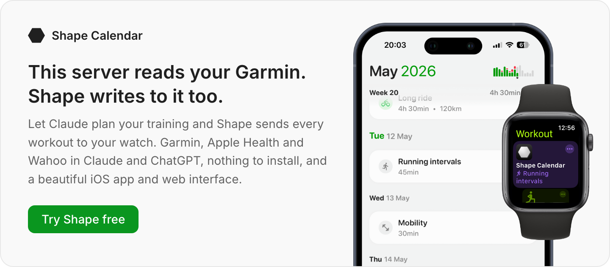

# garmin-personal-mcp

Your whole Garmin history, in Claude. Every activity since your first watch, the original FIT files, sleep, HRV, Body Battery. Runs on your machine with a key only you hold.

In October 2026 Garmin opened a [Personal tier](https://developer.garmin.com/gc-developer-program/overview/) of the Connect API: one key, one person, your own data, no application to file. This is a TypeScript [MCP](https://modelcontextprotocol.io) server over that API, so Claude Desktop, Claude Code, Cursor, ChatGPT or any other MCP client can ask questions of your data directly. It is read-only. Nothing is written to your Garmin account and nothing is sent anywhere except to the AI client you connect.

Not affiliated with Garmin. Garmin and Garmin Connect are trademarks of Garmin Ltd.

<a href="https://shapecalendar.com?utm_source=github&utm_medium=readme&utm_campaign=garmin-personal-mcp">
  <picture>
    <source media="(prefers-color-scheme: dark)" srcset=".github/shape-card-dark.png">
    
  </picture>
</a>

## Quick start

1. Create a key at [connect.garmin.com/app/settings/personalApiToken](https://connect.garmin.com/app/settings/personalApiToken). Pick **1 year**.
2. Save it:

   ```sh
   mkdir -p ~/.config/garmin && chmod 700 ~/.config/garmin
   printf '%s' 'YOUR_KEY' > ~/.config/garmin/connect-personal-api-key
   chmod 600 ~/.config/garmin/connect-personal-api-key
   ```

3. Connect a client:

   ```sh
   # Claude Code
   claude mcp add garmin -- npx -y garmin-personal-mcp
   ```

   ```json
   // Claude Desktop, Cursor, Windsurf, Zed: claude_desktop_config.json or the equivalent
   { "mcpServers": { "garmin": { "command": "npx", "args": ["-y", "garmin-personal-mcp"] } } }
   ```

   ChatGPT and the Claude mobile app can only reach servers over HTTPS. See [Running it on a server](#running-it-on-a-server).

   **From a clone** (no npm needed):

   ```sh
   git clone https://github.com/Shape-Calendar/garmin-personal-mcp && cd garmin-personal-mcp
   pnpm install && pnpm build
   claude mcp add garmin -- node "$PWD/dist/index.js"
   ```

   Use the same `node .../dist/index.js` as the command in any other client's config.

Needs Node 20 or newer. The key can also come from `GARMIN_PERSONAL_API_KEY` or `--api-key-file <path>`. The file path is the one Garmin's own [Python client](https://github.com/garmin/connect-personal-api-python) reads, so the two share a key.

## What you can ask

- "How has my weekly running volume changed over the last three years?"
- "Compare my resting heart rate and sleep this month with the same month last year."
- "Pull the FIT file for yesterday's ride and show me power and heart rate per lap."
- "Find every half marathon I've run and list the finish times."
- "What was my longest ride each year since 2020?"
- "Did my HRV drop before each time I got sick last winter?"

The activity list pages all the way back to the first activity on the account, 50 at a time, each with a compact summary (distance, time, HR, power, training effect, cadence) so the model can scan years without drowning in fields.

## Tools

| Tool | Returns |
|---|---|
| `list_activities` | Activity summaries, newest first. Page with `start`/`limit` (max 50), filter with `startDate`/`endDate`/`activityType`. |
| `get_activity` | Everything Garmin Connect stores for one activity. |
| `get_activity_workout` | The structured workout followed during the activity, if any. |
| `get_activity_recording` | The original FIT file decoded: session totals, every lap, and a downsampled stream of heart rate, power, speed, cadence, altitude and position. |
| `get_daily_summaries` | Steps, floors, intensity minutes, resting HR, stress, Body Battery and calories per day. Up to 180 days per call. |
| `get_sleep` / `get_sleep_summaries` | One night in full (stages, score, respiration, SpO2), or per-night summaries for up to 28 days. |
| `get_hrv` / `get_hrv_summaries` | Overnight HRV for one date, or daily summaries for up to 180 days. |
| `get_body_battery` | Per day, up to 28 days. |
| `get_stress`, `get_steps` | Per day, up to 7 days. |
| `get_hydration` | Per day, up to 28 days. |
| `get_heart_rate` | Resting HR plus timestamped readings for one day. |
| `get_spo2` | Pulse ox and altitude acclimation for one day. |
| `get_wellness_activity_summaries` | All-day movement summaries for a range. |
| `get_weight`, `get_weight_goals` | Measurements and goals, up to a year. |
| `get_food_logs` | Nutrition for one day. |
| `get_profile`, `get_heart_rate_zones`, `get_fitness_age` | Settings, zones per sport, fitness age. |
| `get_vo2_max` | Latest VO₂ max, a specific date, or history for a date range via Garmin Connect. |
| `get_cycling_ftp` | Latest cycling FTP, a specific date, or date-range history via Garmin Connect. |
| `get_training_status` | Latest training status, a specific date, or daily records across a date range via Garmin Connect. |
| `garmin_connect_login`, `garmin_connect_verify_mfa` | Start Garmin Connect sign-in and complete MFA when required. Credentials are deployment secrets, never tool arguments. |
| `get_menstrual_cycle_summary`, `get_menstrual_cycle_day` | Cycle data for a date. |
| `get_raw` | GET any other Personal API path, for endpoints Garmin adds later. |

The per-call range limits are what Garmin's servers accepted on 21 October 2026. Above them Garmin answers 400 or 500 with an empty body, so the tools check the span first and return an error that names the limit. The model splits the range and carries on.

## Running it on a server

The default stdio transport is for a client on the same machine. For ChatGPT, the Claude mobile app, or anything else that connects over HTTPS, run the HTTP mode.

It is stateless: each request builds its own server and transport, no session ids, nothing kept between calls. That is what lets the same code run on a serverless platform or a Raspberry Pi.

**Deploy this repo** on Vercel, Railway, Render or Fly: import it, set two environment variables, deploy.

| Variable | Value |
|---|---|
| `GARMIN_PERSONAL_API_KEY` | the key from Garmin Connect |
| `MCP_BEARER_TOKEN` | a secret you make up, e.g. `openssl rand -hex 32` |

The endpoint is `https://<your app>/mcp` on all of them. Railway, Render and Fly run `pnpm start`, which binds to the port they assign; Vercel imports the same entry and serves it as a function. On Vercel, use the production URL: preview URLs sit behind Vercel's own login, which MCP clients can't pass.

### Optional Garmin Connect metrics authentication

The Personal API tools continue using `GARMIN_PERSONAL_API_KEY`. The three additional performance-metric tools use an independent, unofficial Garmin Connect web-session login. To enable them on Vercel, configure these **private server-side environment variables**:

| Variable | Value |
|---|---|
| `GARMIN_CONNECT_EMAIL` | Garmin Connect account email |
| `GARMIN_CONNECT_PASSWORD` | Garmin Connect password |

No database, KV store, cache, or disk storage is used for Garmin Connect sessions. Session tokens and pending MFA state live only in process memory and disappear when the runtime instance restarts. Configure only `GARMIN_CONNECT_EMAIL` and `GARMIN_CONNECT_PASSWORD` as private server-side environment variables, then call `garmin_connect_login`; if Garmin asks for verification, call `garmin_connect_verify_mfa`. On serverless platforms, login, MFA, and metric requests may reach different instances, and a restart clears authentication; this is the intentional trade-off for no persistent session storage. These tools support latest values by default, `date` for a single date, or `from_date` and `to_date` for an inclusive range (maximum 366 days per call).

**Run it on a machine you own** (a VPS, a home server, a Pi):

```sh
MCP_BEARER_TOKEN=$(openssl rand -hex 32) \
MCP_HOST=0.0.0.0 \
GARMIN_PERSONAL_API_KEY=... \
npx -y garmin-personal-mcp --http 3333
```

The endpoint is `http://host:3333/mcp`. Put TLS in front (Caddy, a Cloudflare tunnel, the host's own proxy).

**Embed it**: `createFetchHandler({ bearerToken, apiKey })` returns a `(Request) => Promise<Response>` for any web-standard runtime (Cloudflare Workers, Deno, Bun, Hono).

Whichever way, clients connect with the URL plus `Authorization: Bearer <MCP_BEARER_TOKEN>`. The token is required: without it, anyone who finds the URL can read your health data.

## Limits, honestly

- **One person.** Garmin's [Personal API terms](https://developer.garmin.com/gc-developer-program/personal/) make the key personal to you, usable only in tools you run for your own use. Deploying your own copy is fine. A hosted service that takes other people's keys is not, and this project will never become one.
- **The key expires.** Thirty days to a year, chosen when you create it. Once a year, make a new one on Garmin Connect and update the file or environment variable. There is no way to renew a key from code. An expired key makes every tool fail with "Token exchange failed".
- **No push or webhooks.** Nothing arrives when you finish a workout; the server only looks when a client asks.
- **No writes.** You can't write workouts to your devices: the Personal API has no write scope.
- **Unpublished rate limits.** Bursts of a few dozen calls caused no throttling in testing. Garmin can change that without notice.
- **Garmin's response shapes are undocumented.** The endpoints are the ones behind the Garmin Connect web app, listed by Garmin's own client. Fields can change.

How the key is handled: it is exchanged for a 24-hour bearer token, which is cached under `~/.config/garmin-personal-mcp` with mode 0600 and refreshed when under an hour remains. The key itself is never written by this server.

## Development

```sh
pnpm install
pnpm dev                     # stdio from source, no build step
pnpm dev --http 3333         # HTTP from source; needs MCP_BEARER_TOKEN
pnpm build && pnpm start     # HTTP from the built output, binds to PORT when a platform sets it
pnpm test
```

Scripts: `dev` runs the TypeScript directly, `build` compiles to `dist/`, `start` serves HTTP from `dist/`. There is no script for stdio from the build because MCP clients spawn `node dist/index.js` themselves.

## This server reads your Garmin. Shape writes to it too.

Let Claude plan your training and [Shape](https://shapecalendar.com) sends every workout to your watch. Garmin, Apple Health and Wahoo in Claude and ChatGPT, nothing to install, and a beautiful iOS app and web interface. Shape uses Garmin's partner API, which can write workouts to your devices and receives new activities the moment they arrive.
